# SprintFlow: Project & Sprint Manager

SprintFlow is a full-stack app for managing **developers, products, sprints and tasks**. It has a FastAPI + MongoDB backend that enforces every business rule, and a Next.js frontend in the style of a Linear-like admin tool, with dark mode, URL-shareable filters and a Kanban board.

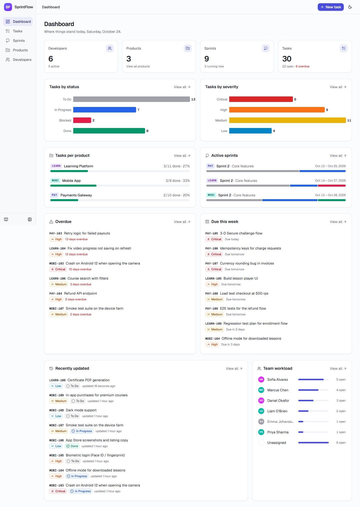

🎬 **Demo video (40 s):** [`docs/demo.webm`](docs/demo.webm) is a tour through the dashboard, filters, task sheet, inline edits, the Kanban board, sprints, products and dark mode. It was recorded with Playwright (`npm run demo`).

- [Features](#features)
- [Screenshots](#screenshots)
- [Tech stack](#tech-stack)
- [Architecture & data model](#architecture--data-model)
- [Local setup (Windows PowerShell)](#local-setup-windows-powershell)
- [Running the tests](#running-the-tests)
- [API](#api)
- [Assumptions & design decisions](#assumptions--design-decisions)
- [Known limitations](#known-limitations)
- [What I'd do next](#what-id-do-next)
- [Troubleshooting](#troubleshooting)

## Features

**Dashboard**
- Totals for developers, products, sprints and tasks.
- Bar charts of tasks by status and by severity. Click a bar to open the Tasks page filtered to it.
- Per-product progress and active-sprint progress bars.
- Overdue and due-this-week lists, team workload, and recently updated tasks.

**Tasks** (the main workspace)
- Debounced search on task number or title.
- Combinable filters: product, sprint (scoped to the chosen product), assignee (including "Unassigned"), severity, status, and overdue.
- Active-filter chips with "Clear all".
- Sortable columns and pagination. All of this lives in the URL, so views are shareable and survive a refresh.
- Inline status and assignee edits with optimistic updates that roll back on error.
- A side sheet with the full edit form and cross-links to the task's sprint, product and assignee.
- A **Kanban board** with drag-and-drop between status columns; it also works with the keyboard.

**Sprints**
- List grouped by product with Upcoming / Active / Completed chips, computed from dates.
- Segmented progress bars per sprint.
- Detail page with timeline, status breakdown and the sprint's tasks.
- A guided **"move tasks to another sprint, then delete"** flow. If tasks' dates don't fit the target sprint, it lists them and offers to fit them in.

**Products**
- Card grid with deterministic tag colors.
- Detail page with Overview, Sprints and Tasks tabs.
- The tag locks once task numbers depend on it.

**Developers**
- Search and an active/inactive filter.
- Deactivation shows a warning with the developer's open-task count.
- Deleting a developer with tasks is blocked; the dialog offers *Deactivate instead* or *Reassign tasks*.
- Bulk reassignment of open tasks.
- Detail page with the developer's tasks.

**UX details**
- Skeleton loaders and empty states with calls to action.
- Error states with Retry, and toasts for success and failure.
- Confirmation dialogs that name the item and explain the consequences.
- Form errors from the server (409/422) mapped onto the right fields.
- Date pickers instead of raw date inputs.
- Focus rings, labeled controls, aria labels on icon buttons, and a skip link.
- Responsive layout: the sidebar is full width on desktop, icons-only on tablet, and a drawer on mobile.

## Screenshots

| | |
|---|---|
| 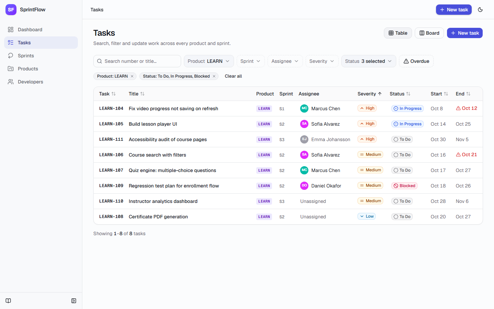 Tasks: URL filters, chips, inline edits | 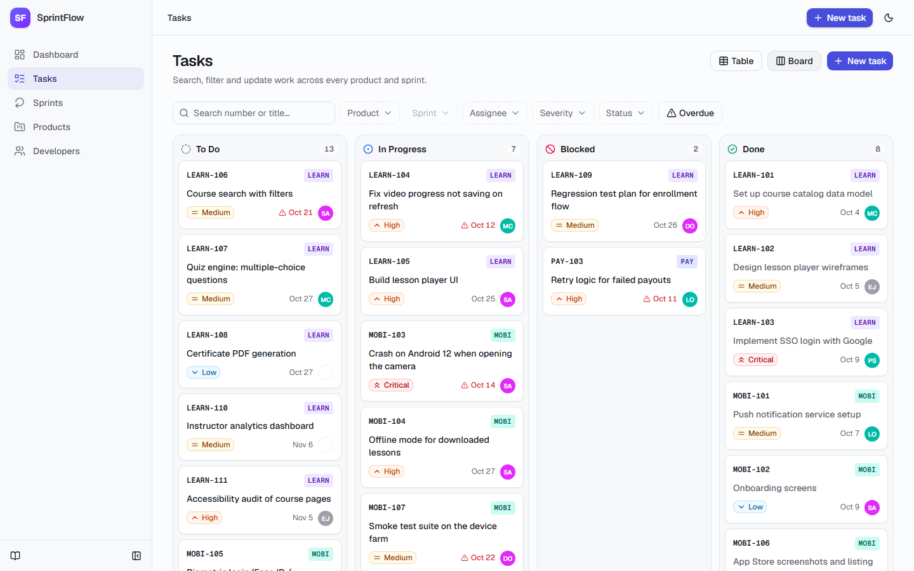 Kanban board (drag-and-drop) |
| 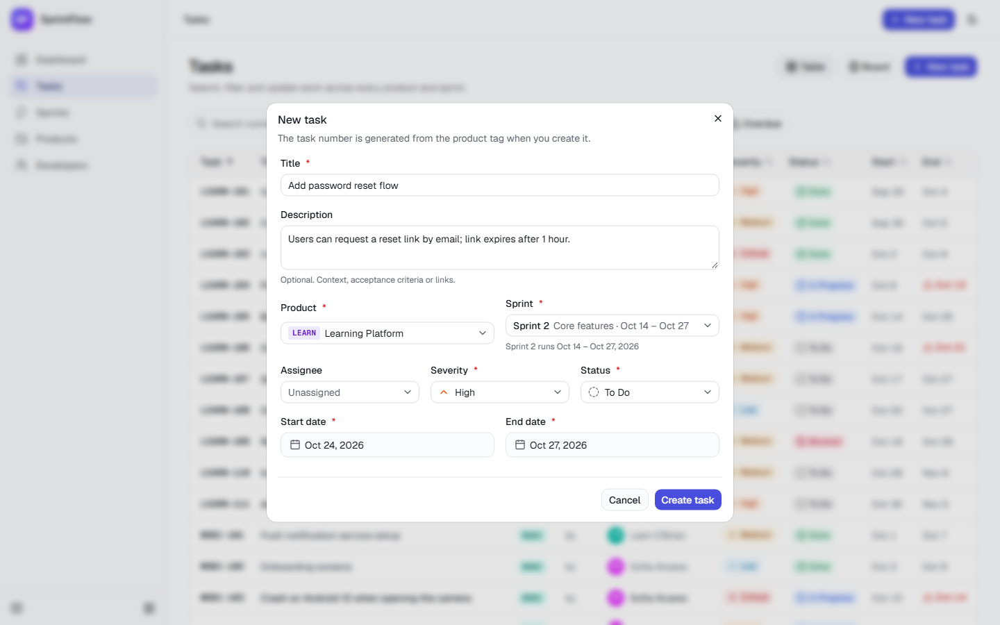 New task form (sprint list scoped to product) | 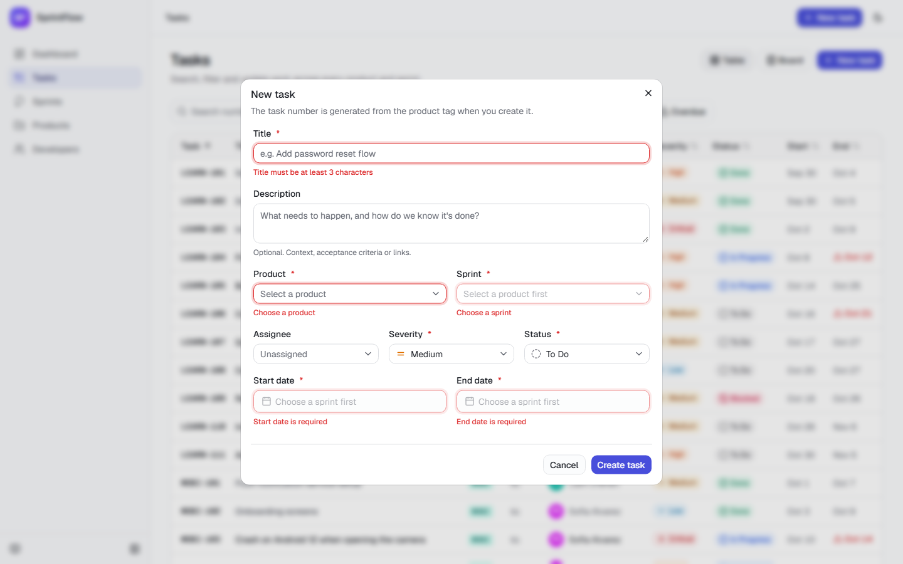 Inline validation errors |
| 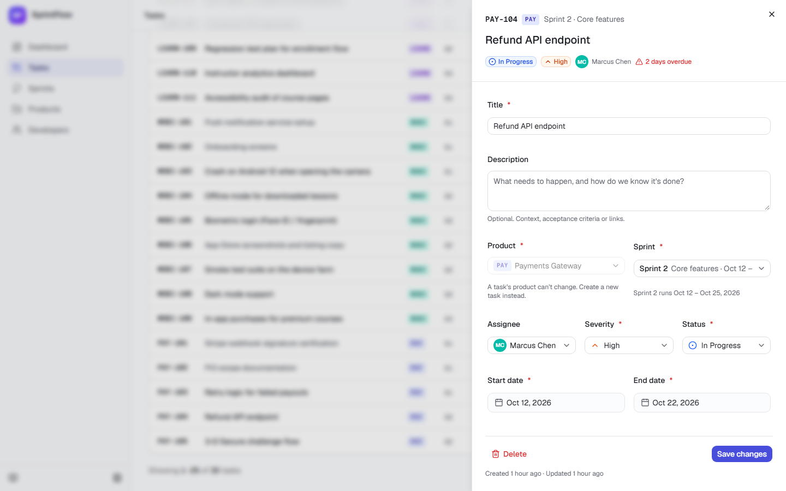 Task detail sheet with full edit | 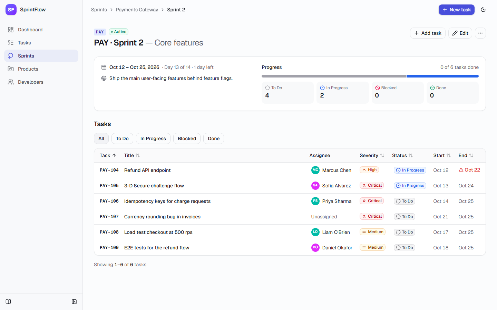 Sprint detail |
| 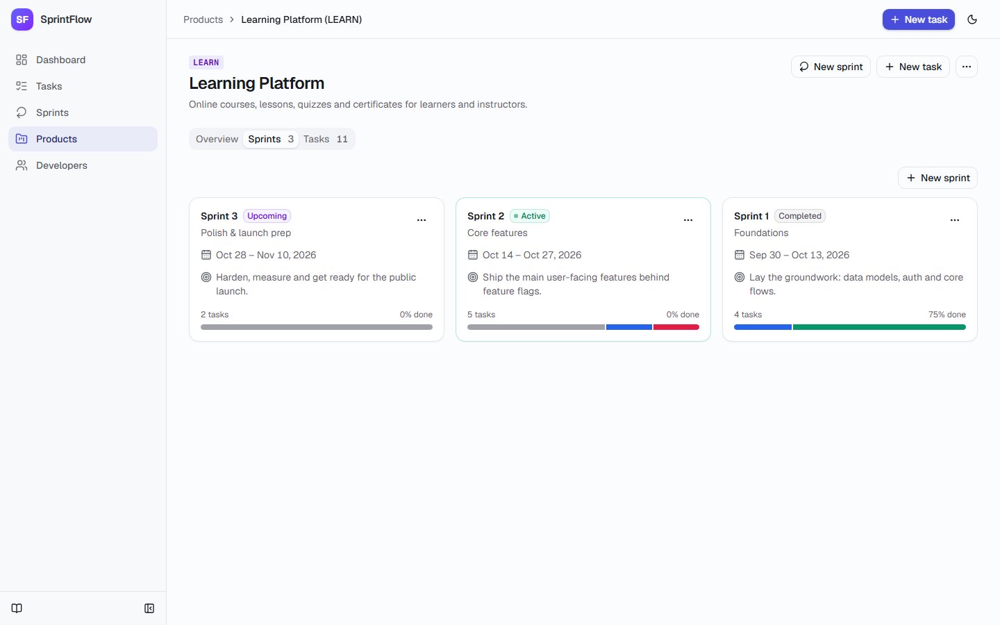 Product detail (Sprints tab) | 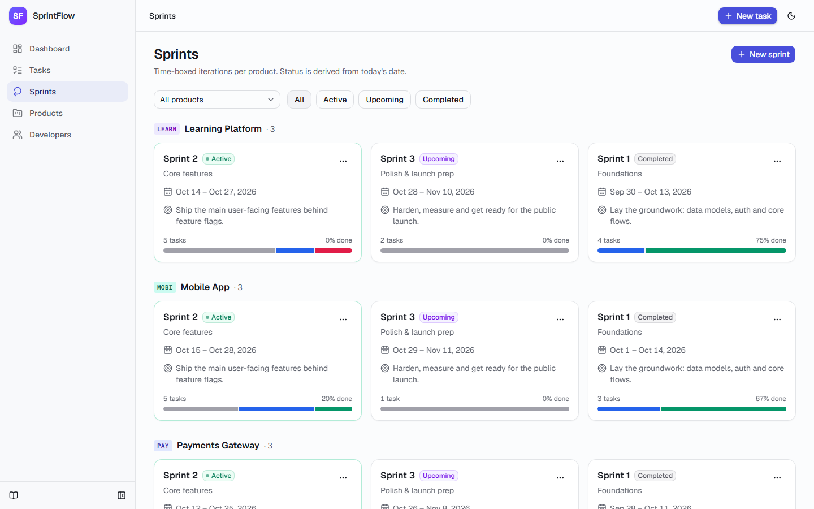 Sprints grouped by product |
| 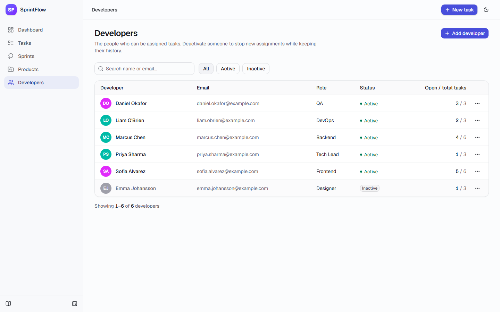 Developers (inactive greyed out) | 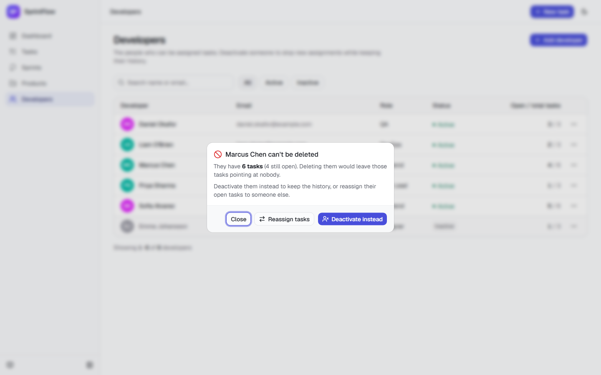 Blocked delete with alternatives |
| 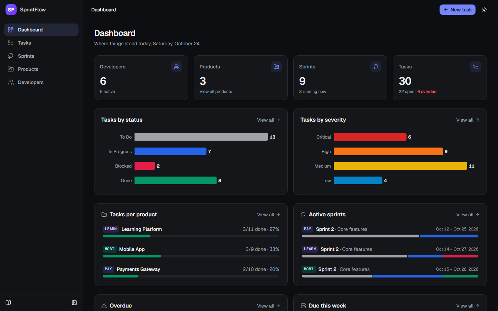 Dark mode | 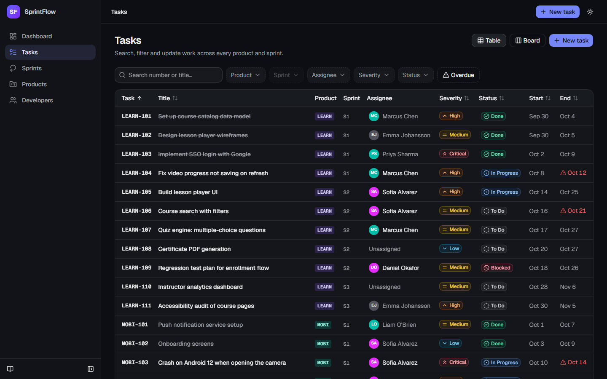 Dark mode: tasks |

The tablet layout at 768px is in [`screenshots/14-tablet-tasks.png`](screenshots/14-tablet-tasks.png). Regenerate all screenshots with `npm run screenshots` (it needs the seed data).

## Tech stack

| Layer | Choice |
|---|---|
| Backend | Python 3.11+ · FastAPI · Pydantic v2 · Motor (async MongoDB) · uvicorn |
| Database | MongoDB (Atlas replica set, or the optional local single-node replica set in `docker-compose.yml`) |
| Frontend | Next.js 16 (App Router) · React 19 · TypeScript · Tailwind CSS 4 · shadcn/ui (Radix) · lucide-react |
| Data & forms | TanStack Query · react-hook-form + zod · date-fns |
| Charts & DnD | Recharts · dnd-kit · sonner (toasts) |
| Tests | pytest + pytest-asyncio + httpx · Vitest + React Testing Library · Playwright |
| Tooling | ruff (lint + format) · ESLint · Prettier |

## Architecture & data model

```
frontend (Next.js, :3000)  ──fetch JSON──▶  backend (FastAPI, :8000/api/v1)  ──Motor──▶  MongoDB
  app/            routes (thin)               routers/    HTTP layer (thin)              sprint_manager
  components/     UI by feature               services/   ALL business rules             sprint_manager_test
  hooks/          TanStack Query hooks        schemas/    Pydantic request/response
  lib/            API client, zod schemas     db.py       indexes + transaction helper
```

- **The backend service layer is the source of truth.** Each rule in the spec lives in `backend/app/services/*`. Routers only translate HTTP. The frontend's zod schemas mirror the rules for instant feedback, but the API re-validates everything.
- **One error shape** everywhere: `{"error": {"code", "message", "details"}}`. Field-level problems are in `details.fields`, which the forms map onto inputs. Validation errors return 422, missing records 404, and conflicts and referential violations 409. Malformed ObjectIds return 404 or 422, never 500.
- **The frontend is client-rendered against the API.** Pages are thin server components that render client views inside a `<Suspense>` boundary, as Next 16's Cache Components requires. All server state goes through TanStack Query. After any write, all queries are invalidated so counts and badges never go stale across screens.

### Collections

| Collection | Fields | Constraints / indexes |
|---|---|---|
| `developers` | name, email (lowercase), role, is_active | unique `email` |
| `products` | name, `name_key` (casefolded), tag, description | unique `name_key`, unique `tag` |
| `sprints` | product_id, number, name, start_date, end_date, goal | unique `(product_id, number)`, `(start_date, end_date)` |
| `tasks` | number, tag, seq, title, description, product_id, sprint_id, developer_id, severity (+rank), status (+rank), start_date, end_date | unique `(product_id, number)`, `(tag, seq)`, plus indexes on sprint_id, developer_id, status, severity, end_date, updated_at, number, title |
| `counters` | `_id` = product_id, seq | one atomic counter per product |

Every document has `created_at` and `updated_at`. The API exposes string ids. Calendar dates are stored as UTC-midnight datetimes and exposed as `YYYY-MM-DD`. Severity and status ranks are stored so MongoDB can sort by them. All indexes are created on startup.

### Consistency guarantees

- **Task numbers** come from `find_one_and_update` on a per-product counter, using a pipeline `$inc` that starts at 101, inside the same transaction as the insert. They are never duplicated and have no gaps. A test runs 20 concurrent creates and gets exactly 101–120.
- **Multi-document operations run in transactions:** move tasks (and optionally delete the source sprint), deletes that check references, reassignment, and tag or date edits.
- **Race-proof referential checks.** Creating or updating a task "touches" its product, sprint and assignee documents (`$inc: {rev: 1}`) inside the transaction. A concurrent delete, date edit or deactivation of those parents writes the same document, so MongoDB raises a write conflict and one side retries against the new state. This closes "check-then-act" races that a plain count-then-delete would leave open.

## Local setup (Windows PowerShell)

### Prerequisites

- **Node.js 20+** and npm
- **Python 3.11+**. The setup script finds it through the `py` launcher (`py -3.13`, `-3.12`, `-3.11`), so an older default `python` on PATH is fine.
- **Git**
- **MongoDB**, either:
  - a MongoDB **Atlas** cluster (the free tier is fine) and its connection string, or
  - **Docker Desktop**, for the optional local MongoDB in `docker-compose.yml`

### 1. Clone and install

```powershell
git clone https://github.com/kaveticharan1/project-sprint-manager.git
cd project-sprint-manager
npm run setup        # creates backend\.venv, installs Python + Node deps (root and frontend),
                     # Playwright Chromium, and copies backend\.env.example -> backend\.env
                     # and frontend\.env.example -> frontend\.env.local (existing files are kept)
```

### 2. Configure MongoDB

Edit `backend\.env` and set `MONGODB_URI`:

- **Atlas:** paste your connection string, e.g. `mongodb+srv://<user>:<password>@<cluster-host>/?retryWrites=true&w=majority`. Add your IP under *Atlas → Network Access*.
- **Local Docker:**
  ```powershell
  docker compose up -d
  ```
  Then set `MONGODB_URI=mongodb://localhost:27017/?replicaSet=rs0&directConnection=true`. The container is a single-node **replica set**, because the app uses transactions.

`MONGODB_DB` must stay `sprint_manager` and `MONGODB_TEST_DB` must stay `sprint_manager_test`. The app, seed and tests refuse to touch any other database.

`frontend\.env.local` holds `NEXT_PUBLIC_API_URL` (default `http://localhost:8000/api/v1`).

### 3. Seed sample data

```powershell
npm run seed          # idempotent: does nothing if the sample data is already there
npm run seed:reset    # wipes the sprint_manager collections, then seeds again
```

The seed script is [`backend/scripts/seed.py`](backend/scripts/seed.py). It goes through the service layer, so every rule and the real task-number counters apply. It creates:

- 6 developers (1 inactive)
- 3 products: Learning Platform/LEARN, Payments Gateway/PAY, Mobile App/MOBI
- 9 sprints: a past, current and upcoming sprint per product
- 30 tasks covering every severity and status, including unassigned and overdue tasks

Dates are relative to today, so the "current" sprint is always current.

### 4. Run

```powershell
npm run dev
```

This starts both servers:

- **App:** http://localhost:3000
- **API:** http://localhost:8000, with interactive docs at **http://localhost:8000/docs**

To run them separately, use `npm run dev:backend` and `npm run dev:frontend`.

> If you prefer working inside the virtualenv: `cd backend; .venv\Scripts\Activate.ps1; python -m scripts.dev`

## Running the tests

```powershell
npm test               # everything: backend, frontend unit and end-to-end
npm run test:backend   # pytest (55 tests)
npm run test:frontend  # Vitest + React Testing Library (26 tests)
npm run test:e2e       # Playwright smoke test (starts the servers if they aren't running)
npm run lint           # ruff check + ruff format --check + ESLint + Prettier
```

**Backend tests** run against the real MongoDB from `MONGODB_URI`, but only inside the **`sprint_manager_test`** database. The fixture refuses any other name, and every test starts with empty collections; documents are deleted and indexes kept. On Atlas the suite takes about a minute because of network round-trips. Coverage:

| Area | Tests |
|---|---|
| Developers | duplicate email (case-insensitive) → 409; delete blocked when they have tasks (with counts); deactivated developers keep their tasks but can't be newly assigned; reassignment; search, filter and pagination |
| Products | duplicate name (case-insensitive) or tag → 409; tag validation; tag immutable once tasks exist; delete blocked with counts |
| Sprints | duplicate number within a product; invalid dates; date edits that would orphan tasks rejected, with the task numbers; product change blocked when the sprint has tasks; move-tasks (reject or clamp) and move-then-delete; state filters |
| Tasks | sequential numbering, including 20 concurrent creates; sprint must belong to the product; dates within the sprint; product immutable; every filter, combined filters, search, sort and pagination; quick edits |
| Dashboard | every total, breakdown and list checked against known data |
| Foundation | error shape, invalid ObjectIds → 404, malformed JSON → 422, database-name guard |

**Frontend unit tests** cover:
- the status and severity badges (icon + text + color);
- the filter toolbar: the sprint filter depends on the product, chips, Clear all, multi-select;
- the task form: sprint options filtered by product and reset on product change, required-field errors, end-before-start, and dates outside the sprint.

**Playwright smoke test:** creates a product, then a sprint, then a task through the UI, and finds the task with filters and search, including after a reload. It runs against the app database with a unique tag and deletes everything it created at the end.

## API

Base URL: `/api/v1`. OpenAPI docs: `/docs`. Health check: `/health`.

| Resource | Endpoints |
|---|---|
| Dashboard | `GET /dashboard/summary` |
| Developers | `GET /developers` (`q`, `is_active`, `role`, paging) · `POST` · `GET/PATCH/DELETE /{id}` · `POST /{id}/deactivate` · `POST /{id}/activate` · `POST /{id}/reassign-tasks` · `GET /{id}/tasks` |
| Products | `GET /products` (`q`) · `POST` · `GET/PATCH/DELETE /{id}` · `GET /{id}/sprints` · `GET /{id}/tasks` |
| Sprints | `GET /sprints` (`product_id`, `state`) · `POST` · `GET/PATCH/DELETE /{id}` · `POST /{id}/move-tasks` · `GET /{id}/tasks` |
| Tasks | `GET /tasks` (`q`, `product_id`, `sprint_id`, `developer_id` or `unassigned`, `severity[]`, `status[]`, `overdue`, `sort`, `page`, `page_size`) · `POST` · `GET/PATCH/DELETE /{id}` · `PATCH /{id}/status` · `PATCH /{id}/severity` · `PATCH /{id}/assignee` |

## Assumptions & design decisions

**Developers**
- Emails are validated, stored in lowercase and unique (case-insensitive). A duplicate returns 409 on the `email` field.
- A developer with **any** task cannot be deleted. The response is 409 with total and open task counts, and the UI offers *Deactivate instead* and *Reassign tasks*. Developers with no tasks can be hard-deleted.
- Deactivation is always allowed. The UI first warns with the number of open (not Done) tasks. Inactive developers keep their tasks, appear greyed out with an "Inactive" badge, are left out of assignee dropdowns, and are rejected by the API for new assignments (422 `developer_inactive`).
- Assignment is validated **only when it changes**, so tasks of a since-deactivated developer can still be edited.
- *Reassign open tasks* moves only non-Done tasks; completed work keeps its original assignee.

**Products**
- Names are unique case-insensitively (through a stored casefolded key).
- Tags are trimmed, uppercased and must match `^[A-Z0-9]{2,8}$`.
- The tag is **immutable once the product has a task**, because task numbers embed it. The API returns 409 `tag_locked`; the UI disables the field and explains why.
- Deleting a product is blocked while it has sprints or tasks (409 with both counts).

**Sprints**
- `start_date <= end_date`. Numbers are unique within a product. If you leave the number out, the **next number** is assigned (inside the transaction).
- The product can't change once the sprint has tasks.
- A date edit that would leave any task outside the new range is rejected with 409, listing the conflicting task numbers.
- Deleting a sprint with tasks is blocked (409 with the count). The guided flow moves its tasks to another sprint of the same product in one transaction, then optionally deletes it. If task dates fall outside the target, the API rejects by default and lists them; `date_strategy: "clamp"`, the UI's *Fit dates and move*, pulls each date to the nearest day inside the target sprint.
- Status (Upcoming / Active / Completed) is derived from today's date (UTC) and never stored.

**Tasks**
- Numbers are `<TAG>-<seq>` starting at 101, per product, and immutable. Numbers of deleted tasks are not reused.
- The sprint must belong to the task's product. Both task dates must fall inside the sprint, with inclusive bounds.
- The product of an existing task can't change (422 `product_immutable`). The sprint can change within the same product, with dates re-validated against the new sprint.
- Defaults: severity **Medium**, status **To Do**, unassigned.
- Title is 3–120 characters; description is at most 5000.
- "Overdue" means the end date is before today and the status is not Done.
- Search is a case-insensitive partial match on number or title, with regex characters escaped.
- Sorting uses stored ranks for severity (Critical first) and status (workflow order), and `(tag, seq)` for numbers, so LEARN-1000 sorts after LEARN-999. Task number is always the tiebreaker for stable paging.

**General**
- A missing *reference* in a request body (an unknown `product_id`, `sprint_id` or `developer_id`) is a **422** on that field. A missing *resource* in the path is a **404**.
- "Today" is the UTC date on the server; the dashboard and the tests use the same clock.
- Filters, sort, page, tab and view are kept in the URL query string.
- Severity and status colors follow the spec (Critical red, High orange, Medium amber, Low blue; To Do gray, In Progress blue, Blocked rose, Done green). They always come with an icon and text. I checked the chart palettes for color-vision deficiencies. Red, orange and amber neighbors are inherently close, so every chart bar is also labeled with its category and value.
- **Deviations from the suggested setup:**
  - shadcn's CLI now defaults to Base UI. I initialized it with `--base radix` to match the spec, and vendored its small `tailwind.css` variant file so the CLI isn't a runtime dependency.
  - I wrote a 20-line zod resolver instead of adding `@hookform/resolvers`, whose peer dependencies conflict with zod 4 and Next 16.
  - `npm run dev:backend` uses a small watchfiles runner (`backend/scripts/dev.py`) instead of `uvicorn --reload`. On Windows, uvicorn restarts its worker by broadcasting Ctrl+C to the whole console, which kills the npm wrapper.

## Known limitations

- No authentication or authorization. The API is open to anything that can reach it, limited only by CORS origins.
- The Kanban board loads up to 200 matching tasks (it tells you when there are more) and has no ordering within a column.
- Dropdowns load up to 200 products, sprints or developers. That's fine for this scale; a large organization would need searchable, async-loaded selects.
- Search uses an unanchored, case-insensitive regex. The indexes on `number` and `title` keep it cheap at this size, but very large datasets would want Atlas Search or a text index.
- The task detail sheet's form keeps the values it opened with. An inline edit made elsewhere while the sheet is open isn't merged in until it's reopened.
- No calendar or timeline view (it was optional).
- Times are UTC. A user far from UTC may see "today" roll over a few hours early or late.

## What I'd do next

1. Authentication (OAuth/OIDC), with per-product roles and an audit log of who changed what.
2. Real-time updates (change streams → WebSockets) so boards and tables update live.
3. Ordering within Kanban columns, bulk task actions, and a sprint timeline (Gantt) view.
4. Comments and attachments on tasks, plus notifications for assignments and due dates.
5. CI (GitHub Actions) running lint and all three test suites against a MongoDB service container, and a containerized deployment for both apps.
6. Full-text search with Atlas Search, and saved filter views.

## Troubleshooting

| Problem | Fix |
|---|---|
| `ServerSelectionTimeoutError` / can't connect to Atlas | Add your current IP under *Atlas → Network Access*, and check the username and password in `MONGODB_URI`. |
| `DNS query name does not exist` / SRV lookup errors | Your network blocks SRV DNS lookups. In Atlas choose *Connect → Drivers* and use the older **standard** connection string (`mongodb://host1,host2,host3/?ssl=true&replicaSet=…&authSource=admin`) instead of `mongodb+srv://`. |
| `Transaction numbers are only allowed on a replica set member` | Your local MongoDB isn't a replica set. Use the provided `docker-compose.yml`, which runs a single-node replica set. |
| `.venv\Scripts\Activate.ps1 cannot be loaded` | Run `Set-ExecutionPolicy -Scope CurrentUser RemoteSigned` once, or just use the npm scripts, which don't need activation. |
| Port 3000 or 8000 already in use | Stop the other process, or run `npm --prefix frontend run dev -- -p 3001`. If the API runs on another origin, also update `CORS_ORIGINS` in `backend\.env` and `NEXT_PUBLIC_API_URL` in `frontend\.env.local`. |

## Project structure

```
backend/
  app/            main.py · config.py · db.py · errors.py · deps.py · utils.py
    routers/      developers · products · sprints · tasks · dashboard
    services/     business rules per entity (+ common helpers)
    schemas/      Pydantic models and enums
  scripts/        seed.py · dev.py
  tests/          pytest suites + fixtures (sprint_manager_test only)
frontend/
  app/            routes: /, /tasks, /sprints[/id], /products[/id], /developers[/id], not-found, error
  components/     layout, badges, forms, dialogs, and feature folders (tasks, sprints, products, developers, dashboard)
  hooks/          TanStack Query hooks, URL state, media query
  lib/            API client and types, zod schemas, formatting, visual metadata
  tests/          unit/ (Vitest) · e2e/ (Playwright smoke + screenshots)
scripts/          cross-platform npm helpers (setup, venv python runner, secret check)
screenshots/      README images (captured by Playwright)
docs/             demo.webm (40 s product tour)
docker-compose.yml  optional local MongoDB (single-node replica set)
```
